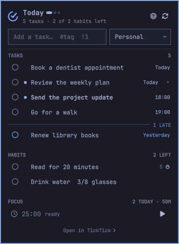
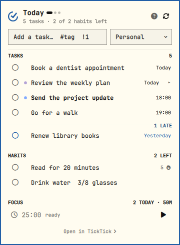
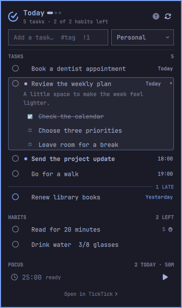

# TickTick for Omarchy

Personal hardened fork of [SotoAugusto/omarchy-ticktick](https://github.com/SotoAugusto/omarchy-ticktick),
with upstream attribution and the MIT license preserved. This fork uses a clean
publication history rather than copying upstream development-session metadata. The plugin ID
and state directory stay unchanged so existing settings and sessions remain compatible.
See [the changelog](CHANGELOG.md) for the credential-handling changes.

This is an unofficial plugin. New browser OAuth and API-token connections use
TickTick's official Open API; existing browser-cookie sessions retain the
undocumented legacy backend. Regression tests are not a guarantee of
whole-plugin security or live-service compatibility.

Version 0.6.0 adds browser authorization without manual cookie copying while
preserving existing legacy connections and settings.

**What's due and what you haven't done yet, in the Omarchy bar.** Tasks,
habits and a focus timer in one popup — add, edit and complete without
leaving the desktop.

## Screenshots

The actual Omarchy Quattro panel, rendered with synthetic sample tasks and
habits. These screenshots contain no real account information.

| Tokyo Night | Flexoki Light |
| --- | --- |
|  |  |

<details>
<summary>Expanded task details and checklist</summary>



</details>

The bar shows a count (` 3  2♦` — three tasks due, two habits open) and
turns urgent when something is late. Left click opens the panel.

## Features

- Tasks due today, tomorrow, or the next seven days — today's work first,
  late work under its own rule with the count, newest slip first
- Edit a task in place — `e` fills the add field with the task's own line
- Completing a task or checking a habit in is a click on its circle — the
  row itself is not a hit target, so a stray click costs nothing
- Habits with today's state and a running streak
- Quantified habits (8 cups of water) advance one step per click
- Quick-add field — type a title, hit enter, it lands due today
- **Undo window** — a completion or check-in is held for a few seconds before
  it is sent, so a misclick costs nothing
- **Due notifications** — an optional desktop notification the moment a task's
  time arrives, batched so five o'clock is one popup and not five
- **Focus timer** — a local pomodoro that counts down in the bar and uploads
  finished blocks; official connections use plugin/default durations, while
  legacy sessions can read your TickTick focus preferences
- Fully keyboard driven, with an in-panel shortcut list
- Tag colours come straight from TickTick; due state follows your Omarchy theme
- Everything is theme aware and follows the bar's vertical/horizontal layout

## Requirements

| Dependency | Required | Why |
|---|---|---|
| Omarchy 4 (Quattro) with Quickshell | yes | the shell that hosts the plugin |
| `python3` | yes | the CLI; standard library only, no pip packages |
| `curl` | no | not used — the CLI speaks HTTP through `urllib` |
| `notify-send` (libnotify) | no | only for due notifications, which are off by default |
| A TickTick account | yes | free accounts work; habits need TickTick's own habit feature |

No external Python packages, no build step, and nothing is compiled.

## Install

```bash
omarchy plugin add https://github.com/Zeus-Deus/ticktick-omarchy-plugin.git --enable --yes
```

Then click the widget in the bar. While disconnected it shows only a muted
TickTick mark; setup instructions are in its tooltip. Clicking it opens the
setup card:

1. Choose **Connect TickTick**. The panel closes and your default browser opens
   TickTick's authorization page.
2. Sign in on TickTick and approve access. The plugin receives a local callback,
   validates the connection and performs its initial sync.
3. Reopen the panel and select an accessible **Quick add list** from the dropdown
   before adding tasks. If none are available, create a list in TickTick first.

The service owns sign-in even while the popup is closed. Reopen it to see
progress, reopen the authorization page, cancel, or retry after a failure.
The callback wait is bounded to three minutes.

This is browser authorization, not extraction of an installed app's login.
**Open TickTick** is separate: it tries the installed app, then the website;
signing in there does not connect this plugin. No browser cookies or desktop
account files are imported by OAuth.

The terminal equivalent is:

```bash
~/.config/omarchy/plugins/io.github.sotoaugusto.ticktick/bin/omarchy-ticktick login --oauth
```

For the advanced fallback, expand **Use an API token instead** and paste an
official access token created in TickTick's **Settings › Account › API Token**.
The field is masked and cleared; the CLI receives the token through stdin
(`login --api-token-stdin`), not argv or a temporary paste file. Treat the token
like a password and revoke it in TickTick if it leaks.

There is no automatic token renewal. When authorization expires or is rejected,
use **Reconnect TickTick** to authorize again. Pending changes remain tied to
their original connection: sync or review them before switching credentials;
they are not silently migrated to a new OAuth session.

## Removal

```bash
omarchy plugin remove io.github.sotoaugusto.ticktick
```

That disables the widget, drops its entry from `~/.config/omarchy/shell.json`,
and deletes the plugin directory. Two things live outside it and are left
behind on purpose, because they are your data and your credential:

```bash
omarchy-ticktick logout                     # forget the token + keyring entry
rm -rf ~/.local/state/omarchy/ticktick      # remove the cache and session file
```

Run `logout` **before** removing the plugin if you want the keyring entry
cleared too — the CLI is what knows how to clear it, and removal deletes the
CLI. Nothing in TickTick itself is touched: no tasks, habits, or focus
sessions are deleted by uninstalling.

## About the API

The documented Open API includes projects, tasks, tags, habits/check-ins and
focus records. Browser OAuth uses provider-supported dynamic registration of
a native public client, PKCE S256 and a loopback callback on `127.0.0.1` with
an ephemeral port. No embedded client secret or developer-app setup is needed.
The callback checks the state and issuer before the code is exchanged.

| Behaviour | Official OAuth / API token | Legacy browser cookie |
|---|---|---|
| Authentication | Bearer access token; `login --oauth` or `login --api-token-stdin` | Existing session, or explicit `login --token -` |
| Tasks and habits | Official endpoints, including habit check-ins | Undocumented v2 endpoints |
| Quick add | Choose an accessible list; CLI requires `--project` | Defaults to the discovered inbox |
| Recurring completion | Supported RRULEs use the official `/complete` endpoint; TickTick advances the series | Plugin computes the next occurrence and sends a v2 batch |
| Focus preferences | Not exposed; use plugin overrides/defaults | Read from account preferences |
| Focus statistics | Derived from returned, ended focus records | Legacy account statistics |
| Uncertain writes | Non-idempotent operations are retained for review, not automatically replayed | Client-ID-based replay for supported queued writes |

Endpoint availability can differ by account or authorization. A 403/404 may
mean a capability is unavailable; the panel exposes errors or warnings rather
than silently switching an official connection to private endpoints. A rejected
credential requires reconnection. Neither backend renews credentials automatically.

Credentials are stored at `~/.local/state/omarchy/ticktick/session.json`, mode
0600. State directories are checked for current-user ownership and tightened
to 0700; symlinked storage paths are refused and atomic temporary files start
private. No password is stored. OAuth tokens and codes are not placed in
command-line arguments or diagnostics. Remote credential-bearing requests use
HTTPS, verify TLS and refuse redirects; the HTTP callback is loopback-only.
Timeouts and response-size limits remain enabled. No new Python dependencies
are required.

### Legacy sessions

Existing browser-cookie sessions remain compatible; they are not automatically
converted to OAuth. To reconnect explicitly to this backend, sign in on
`ticktick.com`, open browser developer tools → **Application → Cookies**, and
copy the value of the **`t`** cookie. Paste it at the hidden terminal prompt:

```bash
omarchy-ticktick login --token -
```

This is a full-access session credential, not an official API token. Never put
its literal value in argv. `login --token-stdin` also remains available for
legacy callers. The older `--token-file` handoff requires an owned private
regular file directly inside the credential directory, bounded to 4096 bytes;
it is consumed before login, including when validation fails.

The private API can change without notice. Scripted password login remains an
explicit legacy fallback, but TickTick's risk control may reject valid credentials
and repeated attempts can flag the account. Prefer OAuth, not repeated password
attempts. `TICKTICK_DOMAIN=dida365.com` applies to the legacy service only;
the official OAuth/Open API endpoints remain on TickTick.

## How it fits together

The shell never talks to TickTick. `bin/omarchy-ticktick` owns the session
and every request, and writes a cache to
`~/.local/state/omarchy/ticktick/data.json`. `Panel.qml` watches that file
and shells back out for writes. So a long-lived credential stays out of the
shell process, and every mutation is one command you can run yourself.

```
bin/omarchy-ticktick   session, API calls, the JSON cache
bin/ticktick_oauth.py  public-client registration, PKCE and local callback
Model.js               task filtering, due labels, habit streaks (node-testable)
Service.qml            everything that must exist once, not once per screen
Panel.qml              the popup — a view of the service
BarWidget.qml          the bar slot
```

### Multiple monitors

A bar surface is created per monitor, so the widget and its panel exist once
per screen. Anything stateful left in the panel is therefore duplicated, and
that is not merely wasteful: two focus clocks each upload the block they
finish, inflating the very statistics the timer exists to keep honest.

`Service.qml` is a `service`-kind plugin, which the shell mounts exactly once
and hands to views through `shell.serviceFor(id)` — the same arrangement the
first-party media plugin uses. It owns the cache, the sync timer, the write
queue, the undo window, and the focus clock. The panels render it and keep
only what is genuinely per-screen, such as which date range that screen is
showing.

Panel routing is the bar's job, not the plugin's. A widget lives once per
monitor, but an IPC target resolves to a single handler, so a keybind used to
open the panel on whichever instance registered first. The bar already
answers this for `shell.summon` by asking Hyprland which output is focused,
so the plugin's own IPC calls borrow that resolution rather than acting
locally.

Two things stay defensive even so, because separate processes are involved:
delivery of the outbox runs under an exclusive lock, and timer-driven syncs
pass `--max-age` so a sync another process just finished is not repeated.

### CLI

```bash
omarchy-ticktick login --oauth               # authorize in the default browser
omarchy-ticktick login --api-token-stdin     # official access token via stdin
omarchy-ticktick login --token -             # legacy browser `t` cookie, hidden prompt
omarchy-ticktick login [--email ADDR]         # legacy password fallback; not recommended
omarchy-ticktick sync [--scope tasks|habits|pomo|full]
omarchy-ticktick add "Pay rent" --project <projectId> --due today [--time HH:MM] [--priority 0|1|3|5] [--tags work,ops]
omarchy-ticktick update <taskId> [--title T] [--due D] [--time HH:MM] [--priority P] [--tags a,b]
omarchy-ticktick complete <taskId>
omarchy-ticktick subtask <taskId> <itemId>    # toggle a checklist item
omarchy-ticktick reopen <taskId>
omarchy-ticktick delete <taskId>
omarchy-ticktick checkin "Read" --toggle    # by name or id
omarchy-ticktick checkin "Water" --value 3
omarchy-ticktick pomo status                # today's focus stats + settings
omarchy-ticktick pomo log --minutes 50      # upload a finished focus block
omarchy-ticktick status                     # cache state as JSON
omarchy-ticktick outbox                     # inspect pending writes locally
omarchy-ticktick outbox discard-reviewed --confirm  # only after checking TickTick
omarchy-ticktick logout
```

Data and mutation commands print JSON on stdout and errors on stderr. Interactive
OAuth/cookie/password login can print plain confirmation text; the panel uses
`login --oauth --json-events` for sanitized newline-delimited JSON progress.
`--api-token-stdin` reads stdin, not a hidden interactive prompt; use the masked
panel fallback for manual pasting. `--project` is required for official creation,
not inferred from an inbox ID. Both task time flags also accept `HH:MM-HH:MM`.

## Settings

Configure in Setup > Plugins, or inline on the bar entry in
`~/.config/omarchy/shell.json`:

| Key | Default | What it does |
|---|---|---|
| `syncInterval` | `5 minutes` | `2 minutes`, `5 minutes`, `15 minutes`, `1 hour`, or `Only when opened`. |
| `horizon` | `Today` | `Today`, `Tomorrow`, or `Next 7 days`. |
| `includeOverdue` | `true` | Count and list work that is already late. |
| `showTasks` | `true` | Show the task section. |
| `defaultProject` | empty | Official quick-add destination, saved by the panel's **Quick add list** dropdown. |
| `showHabits` | `true` | Show the habit section. |
| `maxTasks` | `12` | Rows before the list is capped with a "+N more". |
| `barLabel` | `Count` | `Count`, `Next` (next task's title, scrolling), or `Icon`. Right-click the widget to cycle it. |
| `notifyOnDue` | `false` | Notify when a task's time arrives. Off by default. |
| `notifyLeadMinutes` | `0` | Notify this many minutes early instead. |
| `showPomo` | `true` | Focus section, and a live countdown in the bar. |
| `undoSeconds` | `6` | How long an action is held before sending. `0` disables undo. |
| `pomoMinutes` | `0` | Focus length. `0` uses plugin defaults for official connections, account preferences for legacy. |
| `shortBreakMinutes` | `0` | Short break; same backend-dependent fallback. |
| `longBreakMinutes` | `0` | Long break; same backend-dependent fallback. |
| `longBreakInterval` | `0` | Long break every N blocks; same backend-dependent fallback. |

```json
{
  "bar": {
    "layout": {
      "right": [
        { "id": "io.github.sotoaugusto.ticktick", "horizon": "Next 7 days", "maxTasks": 20 }
      ]
    }
  }
}
```

## Keys and clicks

| Where | Input | Action |
|---|---|---|
| Bar | left | open the panel |
| Bar | middle | sync now |
| Bar | right | cycle the label: counts → next task → icon only |
| Panel | click the circle | complete the task / check the habit in |
| Panel | click the title | cycle the range (Today → Tomorrow → 7 days) |
| Panel | `Open in TickTick ›` | open the web app or desktop app, when installed, and close the panel |
| Panel | `↑` `↓` | move between tasks and habits — into an open task's subtasks too |
| Panel | `enter` | complete the task / check the habit in / flip the subtask |
| Panel | `o` | open the task's details (description, subtasks); again folds and steps back out |
| Panel | `c` | copy the selected task as markdown |
| Panel | `u` | undo the held action |
| Panel | `a` | focus the quick-add field |
| Panel | `e` | edit the selected task in that same field |
| Panel | `r` | sync now |
| Panel | `p` | start or pause focus |
| Panel | `d` / `del` | discard the focus block (not logged) |
| Panel | `g` / `G` | first / last row |
| Panel | `tab` | next bar panel |
| Panel | `v` / `V` | cycle the range forward / back |
| Panel | `?` | show or hide the shortcut list |
| Panel | `esc` | back out one layer, then close |

The shortcut list is reachable both ways: `?` from the keyboard, and the
**?** button in the panel header for the mouse. A shortcut list you can only
reach by shortcut helps the people who need it least.

IPC, for keybindings:

```bash
omarchy-shell io.github.sotoaugusto.ticktick toggle
omarchy-shell io.github.sotoaugusto.ticktick sync
omarchy-shell io.github.sotoaugusto.ticktick focus       # start or pause a block
omarchy-shell io.github.sotoaugusto.ticktick focusStop   # discard it
omarchy-shell io.github.sotoaugusto.ticktick cycleLabel   # counts / next task / icon
```

`toggle`, `open`, `close`, `show`, and `hide` open the panel on the monitor
Hyprland currently has focused, not on whichever copy of the widget happens
to own the IPC target. `sync` goes to every instance, since refreshing is not
a place.

## Tests

```bash
node --test tests/*.test.js
python3 -m unittest discover -s tests -p 'test_*.py'
# Optional native Service/Process checks in an isolated Omarchy VM:
TICKTICK_NATIVE_TESTS=1 python3 -W error::ResourceWarning -m unittest discover -s tests -p 'test_*.py'
```

CI runs the same suite on every push to `main` or `master` and every pull request,
along with a compile check of the CLI and a parse of `manifest.json`.

`Model.js` holds every piece of logic that can be wrong without being
visibly wrong — timezone handling on all-day due dates, streak counting
across a day that is still open, overdue sorting — so it is plain JS with no
QML imports and runs under node.

What a notification decides — which moment fires, once, and what the popup
says — is in there too. That it actually reaches the desktop is one D-Bus
call away from being observable, so check it directly rather than by waiting
for 14:30:

```bash
dbus-monitor --session "interface='org.freedesktop.Notifications',member='Notify'"
```

With that running, set `PROJECT_ID` to an accessible list's ID, add a task due
a minute ago and force a sync — the call should appear once, and not again
when the shell restarts:

```bash
bin/omarchy-ticktick add "Test" --project "${PROJECT_ID:?Set PROJECT_ID to an accessible list ID}" --due today --time $(date -d '1 min ago' +%H:%M)
bin/omarchy-ticktick sync
```

The CLI tests exercise state-changing request paths with an isolated fake
session, so they never read account credentials or contact TickTick.

## Background sync

The interval is a short list rather than a number field, because the useful
range is narrow and the costs are not obvious:

| Option | Meaning |
|---|---|
| `2 minutes` | for a busy shared list; the most this should ever poll |
| `5 minutes` | the default |
| `15 minutes` | fine for a personal list |
| `1 hour` | you mostly add tasks rather than watch them |
| `Only when opened` | no background polling at all |

Opening the panel always syncs, and so do the sync button and `r`, so this
setting governs only the idle case — how fresh the bar's count is while you
are not looking at it.

The shared service owns the timer across monitors. A full sync takes several
requests; the official backend also fetches each accessible project's data,
so cost grows with the number of lists. Timer-driven syncs pass `--max-age`
to avoid repeating a refresh another process just completed. Explicit syncs
never skip, and neither does a sync with anything queued in the outbox.

```bash
omarchy-ticktick sync --max-age 285   # what the timer runs
```

`Only when opened` still syncs once shortly after the shell starts —
otherwise the bar would show a stale count until you first clicked it.

## Due notifications

Off by default. Turn `notifyOnDue` on and the desktop says so when a task's
time arrives, through `notify-send` — the count in the bar is something you
have to look at, and this is the half that comes to you.

```json
{ "id": "io.github.sotoaugusto.ticktick", "notifyOnDue": true, "notifyLeadMinutes": 10 }
```

What it announces, and what it deliberately does not:

| | |
|---|---|
| A task with a time | at that time, or `notifyLeadMinutes` before it |
| A task with a duration | when it **starts** — a meeting `8:30–9:30` arrives at 8:30, not as it ends |
| A task with a date but no time | never: its due "time" is midnight, which is not a moment worth waking anyone for |
| Several at once | one notification listing them, not one popup each |

Whether a task got a time at all is visible as you type it: the quick-add
field shows `Today · 21:00` when it took the clock, and plain `Today` when it
did not — which is the difference between a reminder that fires and one that
never does.

It rides the clock the bar already runs, so nothing new polls: the check is a
pass over the cached task list once a minute, and the only process it ever
starts is `notify-send` itself, and only when there is something new to say. A
sync that pulls in a task that is already due announces it there and then,
rather than holding it to the next minute boundary.

Two things keep it from repeating itself or shouting. What has been announced
is keyed on the **moment**, not the task — a recurring task rolls its due date
forward and earns a fresh reminder, and so does one you reschedule — and that
record is written to
`~/.local/state/omarchy/ticktick/notified.json`, because the shell restarts on
every theme or config change and an in-memory record would announce your 14:30
meeting again at 14:31. And a moment is only announced within an hour of
passing: a laptop that was asleep all morning tells you about the last hour,
not about all of it, and never about yesterday.

The cache is what it reads, so a task completed elsewhere can still be
announced if it comes due inside the sync interval — the notification is as
fresh as the count in the bar beside it. Completing a task here suppresses its
notification immediately, and it stays suppressed while the completion waits
out its undo window, even if a sync lands in the meantime.

That cuts both ways, and it is the one thing worth setting up deliberately: a
reminder can only be as current as your last sync. With **Background sync** set
to `Only when opened`, the cache is refreshed once at startup and then only
when you open the panel, so a task you added on your phone this morning may
never be announced at all. If you want reminders you can rely on, leave
background sync on an interval shorter than the notice you expect.

Switching notifications on does not replay the morning at you. The first check
after you switch them on — for the first time, or off and on again — remembers
whatever is already past as announced without showing it, because nothing can
have been missed before the feature was armed. A reminder whose lead time has
started but whose moment is still ahead is not past, and goes out as usual. A
shell restart is the other case: it catches up on what came due while the shell
was down, within the hour, which is what the record on disk is for.

If `notify-send` is missing or no notification daemon is listening, nothing is
recorded as announced, so the reminders are still waiting once you install one
rather than having been quietly used up.

## Why writes feel immediate

A write costs a sync, and a full sync makes several HTTP requests. Adding a
task cannot change your habits, check-ins or focus settings, so re-fetching
every section afterwards does unnecessary work. Request counts and latency
depend on the backend and the number of projects.

Syncs are therefore scoped. A task write refreshes tasks only, a check-in
refreshes habits only, and a finished focus block refreshes the pomodoro
stats. Sections outside the scope keep their cached values.

```bash
omarchy-ticktick sync --scope tasks     # leave habits and focus cache unchanged
```

On top of that, a quick-added task appears in the list the moment you press
enter, before the request completes. The next cache write replaces it with
the real one. The placeholder row is inert — it has no id yet, so it cannot
be completed by accident.

## Offline

Pending writes are stored privately in
`~/.local/state/omarchy/ticktick/outbox.json`. Safe queued changes are reflected
in the local cache and survive a shell restart. Sync attempts delivery before
refreshing; the panel's cloud/count indicates pending entries, and clicking it
retries eligible work. Not every pending entry is safe to retry.

**Official backend:** task IDs are assigned by TickTick. Task creation, focus
creation and recurring completion have no proven idempotent replay contract.
If their outcome is uncertain, the entry is retained for review and is **not
automatically replayed**. Check TickTick before manually repeating the action:
it may already have succeeded. A retry click does not override this safeguard.
An uncertain creation is not presented as a confirmed server task.

Use `omarchy-ticktick outbox` to inspect pending intent without a network
request. After checking TickTick and resolving those actions there, run
`omarchy-ticktick outbox discard-reviewed --confirm` to remove only entries
explicitly marked for review. This discards local retry intent, not server
records; it cannot undo a write. Ordinary pending entries are preserved in
order. Without `--confirm`, nothing is changed. Sync afterwards to refresh
the cache; remaining ordinary pending work must still be resolved before
switching connections or logging out.

Safe queued updates resolve against current server state. A recurring completion
queued before sending compares the original occurrence's due date before replay;
if the series has advanced elsewhere, it is retained for review rather than
completing the next occurrence. Connection changes do not adopt another
connection's pending work. An entry needing review can block later delivery;
inspect the error and reconcile the pending work before reconnecting.

**Legacy backend:** supported queued writes carry client-generated record IDs.
Replay re-fetches a task before applying whole-object v2 updates, and check-ins
re-query the day's entry. This is the legacy replay mechanism, not a guarantee
for official creates. Active legacy rejections are dropped; transient failures
remain queued. Official failures retain pending entries rather than silently
discarding them. A stalled queue keeps remaining entries in order.

```bash
omarchy-ticktick status     # includes the queued count
```

## Quick add

On the official backend, choose **Quick add list** in the panel first. It lists
accessible, open projects and remembers your selection. Creation is disabled
until a valid list is selected; the plugin does not guess an inbox ID. The CLI
equivalent is `add ... --project <projectId>`. Legacy quick add defaults to its
discovered inbox.

The field takes more than a title:

```
Renew the TLS cert #work !1 tomorrow
```

| Syntax | Does | Whose convention |
|---|---|---|
| `#tag` | attaches a tag, lowercased | TickTick's — `#` is what its apps use |
| `!1` `!2` `!3` | priority: high, medium, low | this plugin's |
| `!high` `!med` `!low` | the same, spelled out | this plugin's |
| trailing `today` / `tomorrow` / `yesterday` / `2026-09-01` | sets the due date | TickTick parses dates from text too |
| trailing `21:00` / `9pm` / `9 pm` / `9:30am` | sets a due hour | TickTick parses times too |
| trailing `21:00-22:30` / `9am-5pm` | sets a duration — both ends must be clocks; an end not after the start spills into the next day | this plugin's |
| `shift+enter` on `gym 6 - 7am` | takes the range the hint offers, as `gym 6am-7am` | this plugin's |
| `on` `for` `due` `by` before either; `at` and `@` before a clock; `@` attached to a day (`@tomorrow`) | filler; goes with the date, not the title | TickTick swallows these too |

Everything not consumed becomes the title, so the line above creates *Renew
the TLS cert*, tagged `work`, high priority, due tomorrow. With no syntax at
all it is a plain task due today.

Editing pre-fills the field with the line that would have created the task —
including its times — so a duration survives an edit by riding along in the
line. Delete the clock from the line and the duration is deleted with it;
the line is always the whole truth.

TickTick has no quick-add symbol for priority — it is still an open request
on their forum — so `!` is defined here rather than borrowed. `#` and the
date words match what TickTick already taught you.

Five details worth knowing:

- A date word only counts at the **end**. `Plan today standup` keeps its
  word; `Standup notes for today` does not, and the preposition goes with the
  date rather than being left dangling. `at` and `@` do the same in front of
  a clock, so `Call mum at 9pm` is a call at nine, not a task called
  "Call mum at" — but not in front of a day, where they usually end a title:
  `Look at today` is a task called *Look at*.
- A duration is a hyphen between two **clocks**. In `gym 6 - 7 am` the `6` is
  a number, not six o'clock, so the line stays in the title and the hint says
  the time was not recognised, rather than the task landing at 07:00 — the end
  of the block — called "gym 6 -". `to`, `till` and an en dash read the same
  way. The glued `gym 6 - 7am` is still read as it always was, because
  `Level 3 - 9pm` has the same shape and is a real title with a real time;
  the hint then names the task, `called “gym 6 -”`, so a half-read range
  shows before enter. Either way a second line under the field offers the
  range — `⇧ enter → 06:00–07:00` — and **shift+enter** takes it, rewriting
  the line to `gym 6am-7am` before it is added. Tags or priority after the
  range come along, a day written in front of it is named
  (`⇧ enter → Tomorrow 06:00–07:00`), and a block may run past midnight
  (`shift 11 - 7am`). A full range the grammar reads implausibly gets the
  likelier reading offered too: `call 1:30-2pm` is read as 01:30 to 14:00, a
  twelve-and-a-half-hour block, and shift+enter offers 13:30–14:00. Plain
  enter never guesses.
- The line under the field says what it understood — `Today · 21:00`, or
  just `Today` when you typed no time. A clock it would not take says so —
  `Today · time not recognised` — and the words stay in the title, so the task
  lands all-day and never notifies. When an edit would change a task's name,
  the hint leads with `Renaming to “…”`. The hint is how you see all of that
  before enter, rather than after.
- An unrecognised `!token` is left alone in the title.
- Tags are lowercased, because that is the key tasks reference them by.

The same syntax is listed under `?` in the panel.

### Editing uses the same line

Press `e` on the selected task and the field fills with the line that would
have created it — `Renew the cert #work !1 tomorrow`. Change it, press enter,
and the task becomes what the line says. Escape cancels.

So there is no separate editor and no second syntax: what you type to make a
task is what you edit to change it. Removal falls out of that — delete
`#work` from the line and the tag is gone, drop `!1` and the priority clears.
A date is applied only when the line carries one, so an undated task stays
undated.

## The view, and what it hides

The panel opens on the horizon you configured — `Today` by default, meaning
overdue work plus today's. That is the point: a bar widget should answer
"what now", not show a backlog.

But a task you just created must never be invisible, so:

- **Click the title** (or press `v`) to cycle the range: Today → Tomorrow →
  Next 7 days → back to Today. `V` steps the other way.
- Position dots beside the title (`● ○ ○`) show how many ranges there are and
  which one you are on. They are deliberately not a chevron: a chevron
  promises a dropdown, and this control cycles.
- The tooltip names where the next click lands rather than a direction, since
  the control wraps — "Show Tomorrow", then "Show Next 7 days", then "Back to
  Today".
- **Adding something due later widens the view automatically.** Type
  `Ship the release tomorrow` from a Today view and the view moves to
  Tomorrow so you can see what you just made.

Widening is a look, not a setting. Closing the panel returns it to your
configured `horizon`, so the default never drifts.

Late is a day, not an hour. A task due at 10:30 is still today's work at
18:00 — it turns late at midnight, when its day is over. Late work sits
under its own rule carrying the count, newest slip first: what went late
yesterday is still the work you meant to do, while something months late
is a decision to take, not a row to act on.

## Long titles

A title wider than the row is elided — until you point at it. **The row under
the mouse, or under the keyboard cursor, scrolls to reveal the rest**, pauses
at the end, and slides back.

Only that one row moves. A list where every long title animates at once cannot
be scanned, and scanning is what the list is for. Nothing scrolls until you
show interest in a specific row, and a row that stops mid-scroll returns home
rather than sitting half off the edge.

The bar behaves the same way in `Next` mode, where the label is a task title:
it scrolls rather than being cut at 28 characters, and pauses at each end
instead of wrapping around. A continuous wrap — the way the media widget
scrolls a track name — leaves the bar slot looking empty for part of every
loop, which a track name can afford and a task reminder cannot. Reading speed
is constant in both places, so a longer title takes longer rather than moving
faster.

The slot keeps a fixed width in `Next` mode. A bar item that resized with
every task title would shove its neighbours sideways each time you completed
something.

## Colours

TickTick stores a colour for **tags** and for **projects**, and this shows the
tag colour as a dot beside the task title. That is the only colour in a task's
data — there is no colour field on a task itself.

Overdue, today, and upcoming have **no colour in the API**. Every TickTick
client paints that itself, so this one paints it from your Omarchy theme
rather than hardcoding their palette: overdue takes the accent colour, today
takes normal foreground, anything further out is muted. Overdue means a day
behind — a timed task counts as today until midnight, though its row still
shows the hour. A fixed red would
fight every theme you switch to.

Priority is the same story — the API gives an integer, not a colour — so a
high-priority task is shown in bold rather than in TickTick's red.

Note that dots only appear on tasks that are both tagged **and** dated, since
the panel lists dated tasks.

## Undo, and why it is a delay

Completing a task or checking a habit in does not fire immediately. The
action is held for `undoSeconds`, an undo row appears, and only when the
window lapses is anything sent. Closing the panel sends everything still held
— closing is not a cancel.

Held actions are a **stack**, not a single slot. Ticking four things off in a
row is how a list actually gets cleared, and holding only the newest would
mean the first three were already gone by the time you noticed the mistake —
the undo window would fail exactly where mistakes cluster. Each action keeps
its own countdown, `u` takes back the most recent, and pressing it repeatedly
walks back through them. The row shows how many are behind the one on offer
(`+2 more`).

It works this way because the alternative does not work. TickTick's own
completion flow rolls a *recurring* task forward and records the finished
occurrence separately, so a later `reopen` cannot put that transaction back.
An undo that never sends the request is the only one that is actually
reversible.

### Recurring tasks

**Official backend:** supported RRULE completions go through the documented
`/project/{projectId}/task/{taskId}/complete` endpoint. TickTick advances the
series server-side; the plugin does not apply legacy date arithmetic or create
its own completed-occurrence copy. Unsupported rules are refused: finish those
in TickTick instead. Isolated live QA verified daily rollover for `repeatFrom=1`
and `repeatFrom=2`; that is not exhaustive verification of every recurrence.
Uncertain results and offline occurrence checks follow the safeguards in
[Offline](#offline). Reopening is not an undo of a series rollover.

**Legacy backend only:** the v2 web-client flow uses two writes: it adds a
*new* task holding the finished occurrence, and updates the live series back
to not-done with its dates moved
on. A generic v2 update sending only `status = 2` therefore does not complete
an occurrence — it ends the series, and every future repetition with it.

So completing a recurring task on the legacy backend sends that pair in one
`batch/task` call. The finished occurrence is a copy with a fresh id, its recurrence
fields cleared and `repeatTaskId` pointing back at the series. The series
keeps its id, stays open, and its start and due dates move by whole days in
the task's own timezone — so a 9am task is still at 9am after the clocks
change, and a duration survives the move. Subtask ticks, progress and focus
summaries reset, because last week's are not this week's.

That means the next occurrence date is computed here rather than by TickTick,
which is the one part of this that can be silently wrong. It covers the
repeats TickTick's picker builds: `DAILY`, `WEEKLY`, `MONTHLY` and `YEARLY`
with an interval, `BYDAY` (including ordinals like `3MO` and `-1FR`),
`BYMONTHDAY` (including `-1` for month-end), `BYMONTH`, `COUNT`, `UNTIL`, and
"repeat from the day I finish". Anything else — TickTick's non-RFC `ERULE`
repeats, lunar calendars, Ebbinghaus spacing, a series with no due date — is
refused with a message rather than guessed at, and stays completable in
TickTick. A refusal costs you one trip to another app; a wrong date silently
reschedules a real task.

An occurrence you skipped in TickTick is not landed on again: the series'
excluded dates are read and stepped over rather than rolled back onto. A
subtask carrying a date of its own moves by the same number of days, so it
does not read as overdue the moment the task rolls over.

A last occurrence completes plainly: an exhausted `COUNT` or a next date past
`UNTIL` has nothing to roll forward, so it becomes an ordinary completion.
Reopening is unchanged throughout — it never rolled anything forward.

The finished occurrence does not carry the series' attachments. Those are
server-side files owned by the live task, and pointing two records at one
upload is worse than a completed copy without them.

## Focus timer

The plugin runs its own local timer; it does not join a clock running in another
TickTick app. Finished blocks upload through official `POST /focus` or legacy
`POST /batch/pomodoro`, according to the stored connection. Endpoint rejection
does not trigger a private-API fallback. An uncertain official upload is saved
for review, not automatically retried; the local timer remains available.

The official API does not expose focus preferences. Its timer uses plugin
defaults unless you set `pomoMinutes`, `shortBreakMinutes`, `longBreakMinutes`
or `longBreakInterval`. For legacy sessions, `0` instead follows account
preferences from `/user/preferences/pomodoro`; non-zero overrides work on both
backends:

```json
{ "id": "io.github.sotoaugusto.ticktick", "pomoMinutes": 25, "longBreakInterval": 3 }
```

Official statistics are derived from returned records with an `endTime` in
today's account-timezone query: the count includes pomodoros, while duration
sums ended pomodoro and stopwatch records using the server's duration in seconds.
This is not an account-wide statistics or daily-goal endpoint, and the plugin
does not interpret undocumented focus status codes. If the focus query fails
without an authentication rejection, cached statistics are retained with a
warning; authentication failures require reconnection.

While a block runs the bar shows the countdown instead of the task count.
Stopping a block early does **not** log it: TickTick counts a pomodoro on
completion, and banking partial blocks would inflate the statistics this is
meant to keep honest.

## Changes

[CHANGELOG.md](CHANGELOG.md) — note that `0.2.0` renames the
`refreshIntervalSec` setting to `syncInterval`.

## Licence and acknowledgements

MIT — see [LICENSE](LICENSE).

Built on Omarchy and Quickshell, using TickTick's official Open API for new
connections and retaining a private v2 backend that other projects mapped out
first. Who contributed what, and what this plugin owes them, is in
[ACKNOWLEDGEMENTS.md](ACKNOWLEDGEMENTS.md).

Unofficial and unaffiliated: not endorsed by or supported by TickTick
(Appest Inc.). Please do not report breakage here to them.

## Limitations

- Core task writes include title/date edits and checklist toggles; moving
  tasks between projects and broader task management stay in TickTick.
- Official account-wide filtering is capped at 200 returned tasks, so inbox
  coverage may be incomplete; reaching that cap produces a warning. Per-project
  reads supplement the filter. Completed-task lookup is also bounded to up to
  200 returned completions, not a full history search.
- Official habit streaks use the check-in history fetched by the plugin
  (currently a 60-day lookback), not a lifetime streak endpoint.
- Capability availability may vary (including 403/404 responses). No automatic
  private-API fallback, automatic renewal, or exhaustive recurrence guarantee.
- Habit check-ins are all-or-step. Arbitrary values need `--value`.
- One account.
- Due notifications need a task to carry a time. A task dated today with no
  time is counted in the bar but never announced.
- The focus timer lives in the shell process. Restarting the shell loses a
  running block; it is not persisted.
- A stopped focus block is discarded, never logged.
